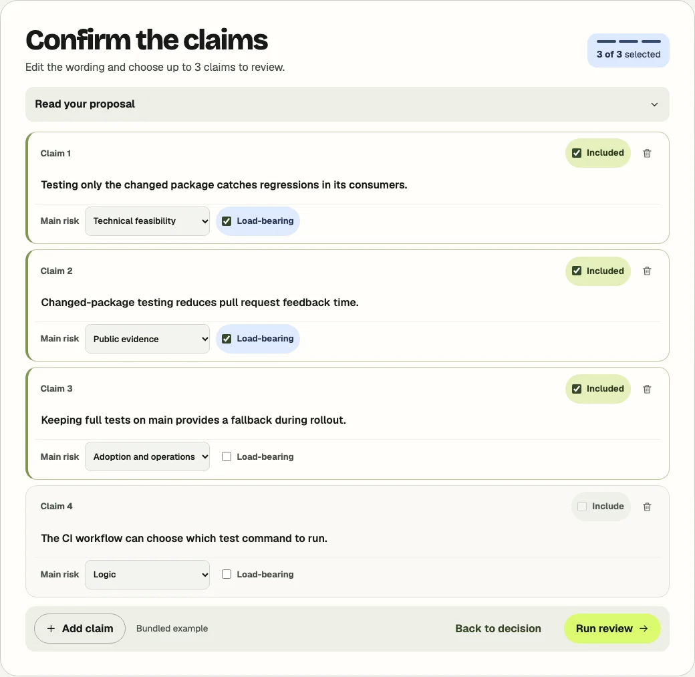

<p align="center">
  
</p>

<h1 align="center">Tactile</h1>

<p align="center">Pressure-test engineering decisions before committing to a rollout.</p>

<p align="center">
  <a href="https://tactile-compute50.onrender.com/">Open Tactile</a> ·
  <a href="#quickstart">Run locally</a> ·
  <a href="CONTRIBUTING.md">Contribute</a>
</p>

[](https://github.com/SammyRyuga/tactile/actions/workflows/ci.yml) [](LICENSE)


Tactile turns a proposed change into testable claims. It routes those claims to the checks that matter, records the evidence behind each verdict, and produces a Markdown decision memo for a design review or pull request.

## Try a review

Open `/demo` on a current build to try CI coverage, replica consistency, or feature-flag rollback. Inspect and edit claims, replay the recorded evidence, and export a Markdown memo. The public demo runs entirely in the browser and requires no account or model key. Claims outside the recorded evidence return **Unresolved**. [90-second Round 1 walkthrough](docs/round1-demo.md)

## Use the signed-in workspace

1. Sign in to [Tactile](https://tactile-compute50.onrender.com/login).
2. Open **Workspace**, describe your plan or add a file or link, then select **Analyze my plan**. If more detail is needed, Tactile asks a follow-up question. Choose a case from the **Example library** to try a recorded review first.
3. In **Review assumptions**, edit the statements and choose which to check. Mark assumptions the plan depends on as critical. Open **Advanced settings** to change reviewers, the decision deadline or reversibility, risk priorities, or engineering checks.
4. Select **Run checks**. The results show the recommendation and verdicts first. Open a finding’s **Review trail** to inspect its evidence, then copy or export the Markdown report. Recent reports are available in the same signed-in tab.

**Add a file or link** accepts public HTTPS pages, PDFs (including scanned PDFs), PNG/JPEG/WebP screenshots, and text or Markdown files. You can start with an attachment alone. Each upload can be up to 4 MB and each PDF up to 15 pages. Tactile keeps up to three excerpts of up to 2,400 characters each and sends the extracted text to your configured model during claim extraction and review. Edit those excerpts under **Advanced settings → Project evidence**.

In **Advanced settings**, open **Add an engineering check** for an assumption to enter retry, SLO, timeout, throughput, or weighted-average inputs. Tactile calculates the result and passes it to Crossfire as review context.

When a live memo has Steelman fixes, **Revise your plan** lets you choose which fixes to apply and edit the revised draft before using it. In a live report, use **Settle this claim** for a downloadable measurement check, **Re-review this claim** to run one claim with additional evidence, or **Track after rollout** to save a claim in the workspace’s outcome log. The outcome log stays on this device for your account and can be exported as JSON.

The example library covers changed-package tests, replica consistency, and feature-flag rollback. Live reviews send your proposal to the configured provider and use web search where applicable. Use proposals you can share with the provider.



## Settings

Open **Settings** after signing in. Use the header theme button to switch between light and dark. Tactile remembers your theme in that browser. The claim editor and other animated surfaces respect the system’s reduced-motion preference.

To configure a hosted live review, paste your **Meta Model API key** in Settings and choose Muse Spark, Ember, or Wonder. **Save key** checks model metadata. If that check is inconclusive, **Test model and save** can send one short generation request. Meta controls access and bills requests to the key’s account. Tactile stores the key in server memory for the sign-in session for up to eight hours. Use **Remove key** to clear it sooner. Signing out or restarting the server also clears it. Live model access for the team’s account remains unverified. [Live verification procedure](docs/meta-live-verification.md) · [Meta Model API documentation](https://dev.meta.ai/docs/overview)


## Quickstart

Install Node.js **22.19 or later in the 22.x line**, or **24 or later**.

```sh
git clone https://github.com/SammyRyuga/tactile.git
cd tactile
npm ci
npm run dev
```

Open the [public demo on localhost](http://127.0.0.1:5173/demo). To serve the production build locally, use `npm run build` followed by `npm start`.

To use the authenticated workspace, install Python 3.13 and create the local worker environment. On macOS or Linux, run `TACTILE_BOOTSTRAP_PYTHON=python3.13 npm run setup:crossfire`. On Windows, run the following from the repository root.

```powershell
py -3.13 -m venv .venv
.\.venv\Scripts\python.exe -m pip install -r server/crossfire/requirements.txt
```

Set `TACTILE_PYTHON` to the absolute path of the virtual environment’s Python executable if you install it outside `.venv`. Copy `.env.example` to `.env`, configure a Supabase project with email/password sign-in, and set `SUPABASE_URL` and `SUPABASE_PUBLISHABLE_KEY`. Apply the [Supabase quota migrations](supabase/migrations) in order. Allow `http://127.0.0.1:5173/login` in Supabase Auth and restart Tactile.

| Variable                   | Purpose                                                                     |
| -------------------------- | --------------------------------------------------------------------------- |
| `SUPABASE_URL`             | Supabase project URL.                                                       |
| `SUPABASE_PUBLISHABLE_KEY` | Public key for browser authentication and authenticated quota calls.        |
| `OPENAI_API_KEY`           | Optional developer-only key for local reviews. Hosted reviews use Meta.     |
| `OPENAI_MODEL`             | Model for live extraction, review, and search. Defaults to `gpt-5-mini`.    |
| `OPENAI_VERIFIER_MODEL`    | Optional model for OpenAI passage verification. Defaults to the main model. |
| `PORT`                     | HTTP port. Defaults to `5173` locally.                                      |
| `ALLOWED_HOSTS`            | Comma-separated API hostnames for additional domains.                       |

## How review works

- **Claim Map.** Crossfire extracts testable assumptions and selects an adversarial panel. Confirm any or all claims before running tests.
- **Isolated tests and cross-examination.** The selected evaluators test claims independently, look for evidence, and follow up on critical blockers.
- **Decision Memo.** Crossfire’s Steelman reconciles findings into **Survived**, **Weakened**, **Broken**, or **Unresolved**. The memo records **Proceed**, **Proceed with Changes**, **Hold**, or **Drop**, with its deciding factor, dissent, and next actions when available.

Tactile runs the pinned [Crossfire Python engine](server/crossfire/upstream/README.md) for authenticated live reviews. Tactile supplies the selected model, web search, and its bounded public-page fetcher. The browser uses the existing interface and report storage. Bundled examples retain their recorded results.

The browser keeps drafts and completed reports in the tab’s session storage. Refreshing during a review restores the confirmed claims so you can retry. `POST /api/claims` extracts claims and `POST /api/reviews` streams update events as NDJSON. Both require a verified session.

## Operator Room

Expand **Operator Room** to see the selected reviewers and their status. Recorded examples replay saved activity. Live reviews show events as they arrive. The memo and Markdown export are available independently of the room.

Desktop localhost can also show the original 3D scene. Place the authorized GLB at `build/control-room-assets/control-room.glb`, run `npm run dev`, and select **Load local 3D preview** in the room. Production builds include the text-based room. The 3D viewer and GLB stay local while Worker robot distribution rights and broader device performance are pending. [Local preview](docs/blender-scene.md) · [Blender asset and tool handoff](docs/operator-room-handoff.md)

### 3D asset credits

The Operator Room scene and its integration are developed by Team Tactile. The scene includes adapted third-party models:

- [SafetyBotBust](https://www.blendswap.com/blends/view/71997) by [masterxeon1001](https://www.blendswap.com/users/view/masterxeon1001), licensed under [CC BY 3.0](https://creativecommons.org/licenses/by/3.0/). Adapted as Steelman with updated materials, eye lighting and head motion.
- [Maintenance Hoverbot — rigged, animated](https://www.blendswap.com/blends/view/77451) by [ClayOgre](https://www.blendswap.com/users/view/ClayOgre), licensed under [CC BY 3.0](https://creativecommons.org/licenses/by/3.0/). Adapted with four reviewer skins and station animations.
- Worker robot (couriers): the team confirms that this asset is free to redistribute and does not require attribution.

The two CC BY 3.0 models retain their original licenses; the repository's MIT software license does not replace those terms. See the [asset handoff](docs/operator-room-handoff.md) for provenance and export details.

## Deploy to Render

Follow the [deployment and staging guide](docs/DUAL_DEPLOYMENT.md) to verify the deployed commit and run the public demo smoke tests. A current build serves the anonymous examples at `/demo` and protects the workspace at `/review` and `/settings`. On an authenticated Render service, `npm run build` installs and checks the pinned Python dependencies. Independent staging is available for rehearsals.

## Development and evaluation

```sh
npm run check
npx playwright install chromium
npm run test:e2e
```

The evaluation dataset has separate 15-case development and holdout sets, baselines, and a scoring rubric. A one-pass Meta baseline comparison is available, with human grading pending. [Evaluation protocol](docs/evaluation.md) · [Project progress](progress.md) · [Contributing guide](CONTRIBUTING.md)

### Review limits

Tactile shares an hourly quota across live review, assumption extraction, revision and document import for each authenticated account. The original default remains 12. In a separately authorized test database, a database owner can use the SQL editor to set a higher quota (for example, 40), after applying the additive quota settings migration. Update the same row back to 12 to restore the default.

```sql
update tactile_private.review_quota_settings
set hourly_limit = 40
where singleton;
```

The database accepts 1–120 attempts per account per rolling hour. The browser cannot set the quota, and the application delegates to the database when Supabase Auth is configured. The public recorded demo runs locally without this quota. Attachment requests are limited to 8/minute per IP, session verification to 30/minute per IP and status/provider settings to 60/minute per IP. The production HTML route fallback permits 300/minute per IP. The server allows two concurrent live operations, one document read and up to 32 key validations (one per session).

For a self-managed reverse proxy, set **TRUSTED_PROXY_RANGES** to the verified socket peer CIDRs and configure that proxy to supply the actual client IP as the rightmost forwarded address. Restrict direct access to the app server as appropriate. The existing Render configuration assumes a single trusted immediate hop. Meta account usage and billing are separate, and Tactile forwards a valid provider Retry-After value when available.

## Credits

Built by [Ryan Fernandes](https://github.com/ryanfer123), [Samanyu Pattanayak](https://github.com/SammyRyuga) and [Aritra Ghosh](https://github.com/aritraghosh2005). Tactile’s original code and documentation are available under the [MIT License](LICENSE).

Tactile includes Crossfire’s original review, file ingestion, and plan revision code under the [upstream MIT license](server/crossfire/upstream/LICENSE). [Crossfire repository](https://github.com/hriday-singh/crossfire) · [Technical breakdown](https://www.linkedin.com/pulse/crossfire-technical-breakdown-ashutosh-padhy-wnaqc/)

The homepage illustration is original artwork generated for Tactile. The site uses Bricolage Grotesque and Geist with GSAP and Lenis for motion.
