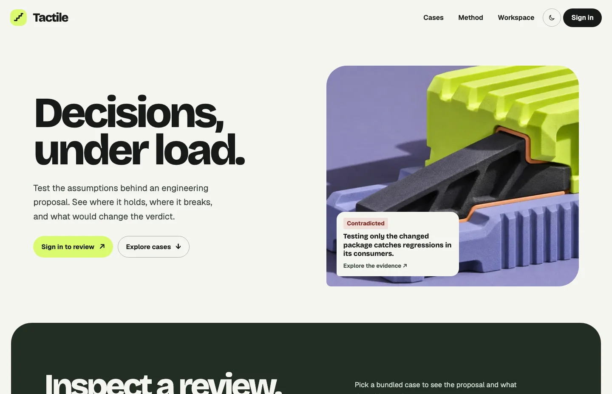
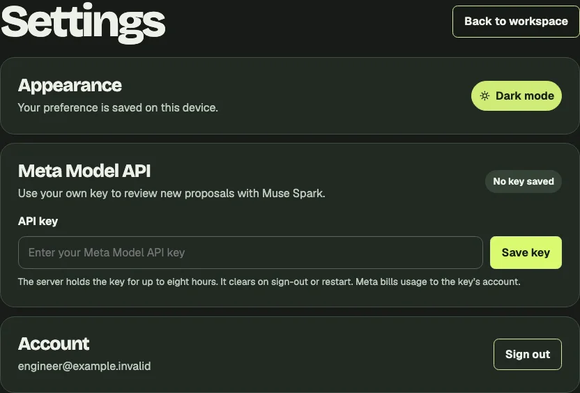

<p align="center">
  
</p>

<h1 align="center">Tactile</h1>

<p align="center">Pressure-test engineering decisions before committing to a rollout.</p>

<p align="center">
  <a href="https://tactile-compute50.onrender.com/">Open Tactile</a> ·
  <a href="#quickstart">Run locally</a> ·
  <a href="CONTRIBUTING.md">Contribute</a>
</p>

[](https://github.com/SammyRyuga/tactile/actions/workflows/ci.yml) [](LICENSE)



Tactile turns a proposed change into testable claims. It routes those claims to the checks that matter, records the evidence behind each verdict, and produces a Markdown decision memo for a design review or pull request. Built for **Compute 50 · Domain 9 · Developer Productivity and Intelligent Automation**.

## Try a review

1. Sign in to [Tactile](https://tactile-compute50.onrender.com/login).
2. Open **Workspace**, enter a proposal, and select **Extract claims**. To explore first, choose a case from the **Example library**.
3. Edit the claims, select up to three, and mark any that would change your decision if they failed as **Load-bearing**.
4. Select **Run review**. Open a finding’s **Review trail** to inspect the checks and evidence, then copy or export the report as Markdown. Recent reports are available in the same signed-in tab.

The signed-in examples cover changed-package tests, replica consistency, and feature-flag rollback. They use bundled evidence and work without a provider key. Live reviews send your proposal to the configured provider and use web search where applicable. Use proposals you can share with the provider.


## Settings

Open **Settings** after signing in. Use the header theme button to switch between light and dark. Tactile remembers your theme in that browser. The claim editor and other animated surfaces respect the system’s reduced-motion preference.

To configure live reviews, paste your **Meta Model API key** in Settings. Tactile checks that the key can run Muse Spark before saving it. Tactile keeps the key in server memory for the current sign-in session for up to eight hours. Signing out or restarting the server clears it. Settings never displays the saved value. Use **Remove key** to clear it before the session expires. Meta bills usage to the key’s account. The hosted app requires each user to add their own key for live reviews. [Meta Model API documentation](https://dev.meta.ai/docs/overview)



## Quickstart

Install Node.js **22.19 or later in the 22.x line**, or **24 or later**. You’ll also need a Supabase project with email/password sign-in enabled.

```sh
git clone https://github.com/SammyRyuga/tactile.git
cd tactile
npm ci
cp .env.example .env
```

Set `SUPABASE_URL` and `SUPABASE_PUBLISHABLE_KEY` in `.env`. Apply the [review quota migration](supabase/migrations/20261121000000_review_quota.sql) before running a live review. In Supabase Auth, allow `http://127.0.0.1:5173/login` as a redirect.

```sh
npm run dev
```

Open [Tactile on localhost](http://127.0.0.1:5173/). Sign in with a verified Supabase account. To run the production build locally, use `npm run build` followed by `npm start`.

| Variable                   | Purpose                                                                     |
| -------------------------- | --------------------------------------------------------------------------- |
| `SUPABASE_URL`             | Supabase project URL.                                                       |
| `SUPABASE_PUBLISHABLE_KEY` | Public key for browser authentication and authenticated quota calls.        |
| `OPENAI_API_KEY`           | Optional OpenAI key for local reviews. Keep it out of source control.       |
| `OPENAI_MODEL`             | Model for live extraction, review, and search. Defaults to `gpt-5-mini`.    |
| `OPENAI_VERIFIER_MODEL`    | Optional model for OpenAI passage verification. Defaults to the main model. |
| `META_VERIFIER_MODEL`      | Optional model for Meta passage verification. Defaults to Muse Spark.       |
| `PORT`                     | HTTP port. Defaults to `5173` locally.                                      |
| `ALLOWED_HOSTS`            | Comma-separated API hostnames for additional domains.                       |

## How review works

- **Claim selection.** Extract up to six claims from a proposal and confirm up to three for review.
- **Checks by risk.** Route claims to specialist checks for assumptions, engineering feasibility, or adoption and operations. Load-bearing claims get a larger search allowance. Explicit equations in claim text are checked with deterministic arithmetic.
- **Evidence and verdict.** Verify excerpts fetched from cited pages. Proposal-derived findings reference an explicit premise, and deterministic arithmetic can establish a contradiction directly. Keep source links and check observations visible in the report. “No credible break found” records a completed adversarial check without a detected concern. An unresolved verdict identifies evidence gaps, conflicting sources, or a failed check.
- **Decision memo.** See the smallest viable change and tradeoff when the review identifies a repair. Export the findings and review trails as Markdown.

The browser keeps drafts and completed reports in the tab’s session storage. Refreshing during a review restores the confirmed claims so you can retry. `POST /api/claims` extracts claims and `POST /api/reviews` streams update events as NDJSON. Both require a verified session.

## Deploy to Render

1. Create a Node web service from this repository. Use `npm ci --include=dev && npm run build` as the build command, `npm start` as the start command, and `/health` as the health check.
2. Set `SUPABASE_URL` and `SUPABASE_PUBLISHABLE_KEY` on the service. Apply the [review quota migration](supabase/migrations/20261121000000_review_quota.sql) to the database.
3. Set the Supabase Auth **Site URL** to the deployed HTTPS origin and allow its `/login` redirect. Configure SMTP if you offer email confirmation for public sign-ups.
4. Open Tactile, verify sign-in with an authorized account, and complete a bundled example. Add a provider key in Settings to exercise a live review.

## Development and evaluation

```sh
npm run check
npx playwright install chromium
npm run test:e2e
```

The evaluation dataset has separate 15-case development and holdout sets, baselines, and a scoring rubric. A one-pass Meta baseline comparison is available, with human grading pending. [Evaluation protocol](docs/evaluation.md) · [Project progress](progress.md) · [Contributing guide](CONTRIBUTING.md)

## Credits and license

Tactile was built by [ryanfer123](https://github.com/ryanfer123) and [SammyRyuga](https://github.com/SammyRyuga). Tactile’s original code and documentation are available under the [MIT License](LICENSE).

Crossfire inspired the claim-review approach, including checks selected by risk and a report that traces verdicts back to evidence. [Crossfire repository](https://github.com/hriday-singh/crossfire) · [Technical breakdown](https://www.linkedin.com/pulse/crossfire-technical-breakdown-ashutosh-padhy-wnaqc/)

The homepage illustration is original artwork generated for Tactile. The site uses Bricolage Grotesque and Geist with GSAP and Lenis for motion.
